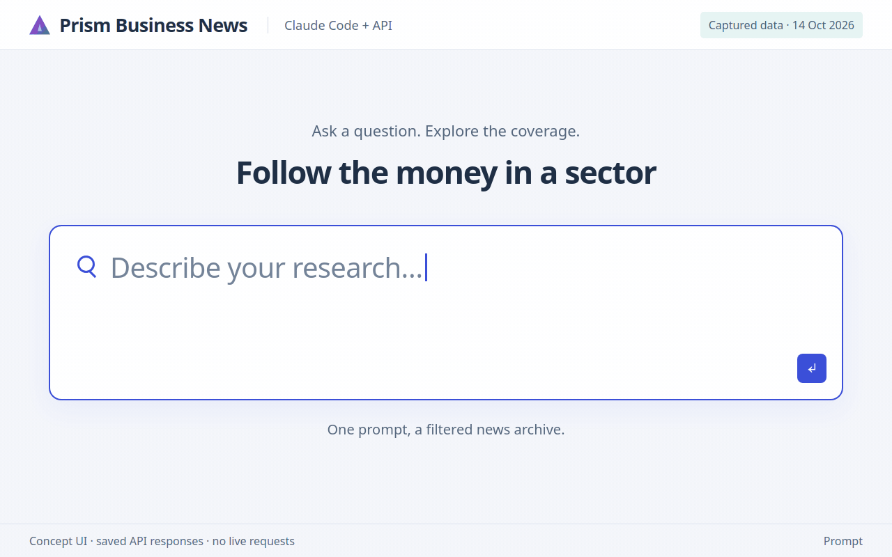
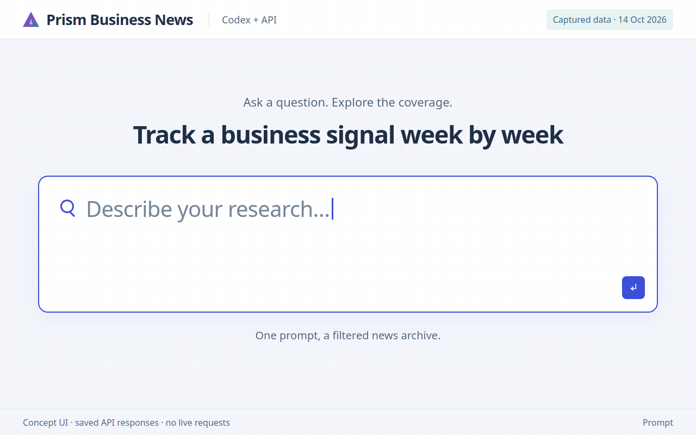
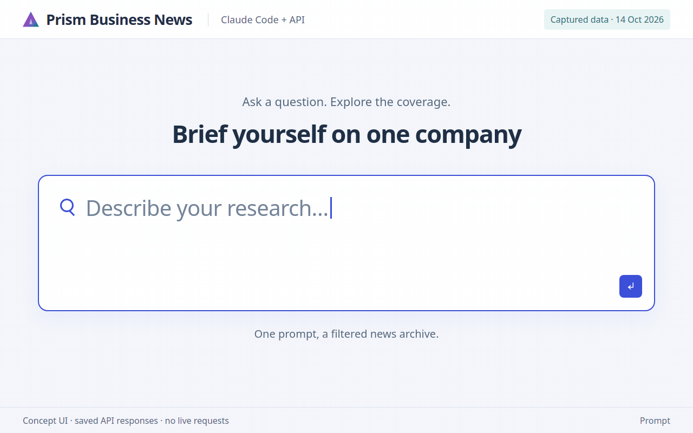
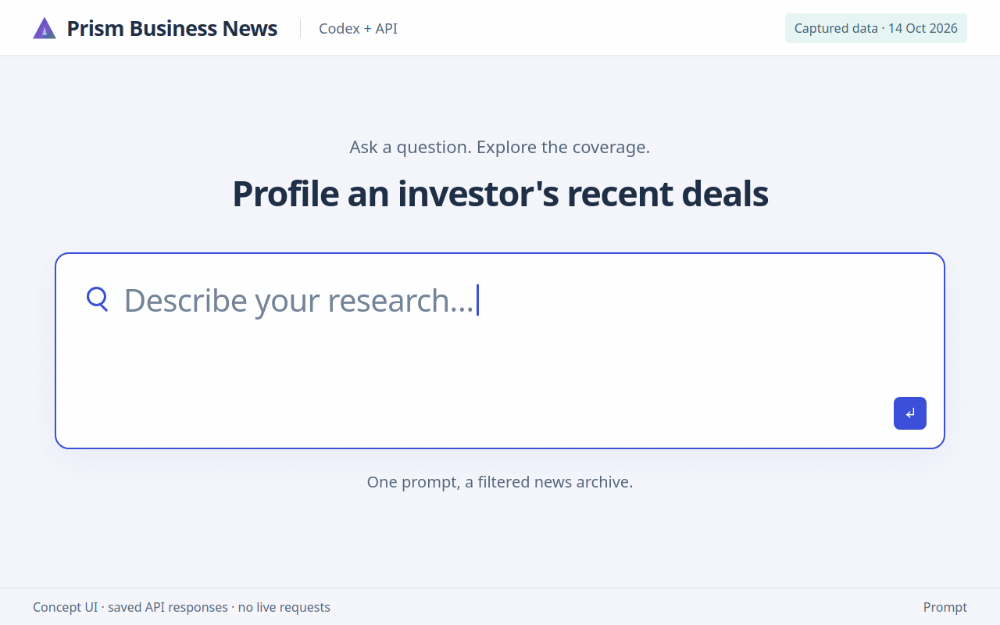
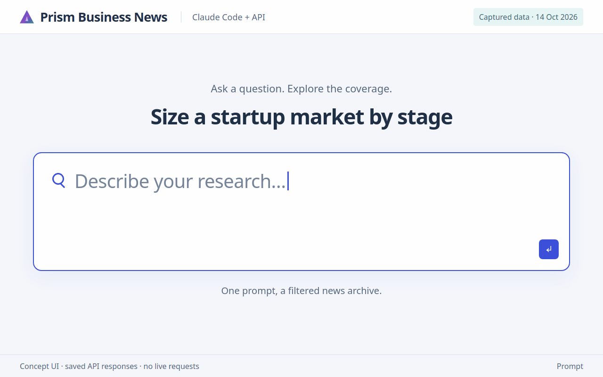
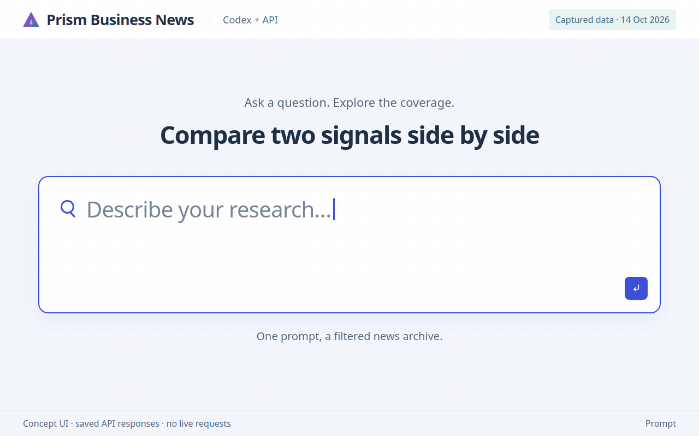

# Prism Business News with Claude Code or Codex: 6 animated use cases

These GIFs show **client-built research UI concepts**: a large typed prompt slides
off-screen, a full-screen chart appears, then a detailed result view follows. Each
32-second loop gives the prompt and the results their own space. The request
recipes list the Prism Business News API calls behind each view. They are not screen
recordings of the official Claude Code or Codex interface; an assistant with your
API key can call these endpoints and build a similar local view when you ask.

Open the [interactive gallery](demos/index.html) locally for play/pause, replay,
copyable prompts, request recipes, GIF downloads and still images. All GIFs also
render below on GitHub. Each carries a persistent data-provenance badge.

| Workflow | Displayed evidence |
|---|---|
| AI funding · April 2026 | Saved funding listing, AI sector, April 2026 |
| Layoff tracker · April 2026 | Saved layoff events, April 2026, all pages |
| Company event mix | Saved company events for openai.com |
| Investor activity | Saved funding deals naming Sequoia, all pages |
| India early-stage · Q1 2026 | Saved funding deals, India, seed to Series B, all pages |
| Hiring vs layoffs · Q1 2026 | Saved job-creation and layoff events, Q1 2026, all pages |

Every demo here is computed from saved responses of the real API, captured on the date in its badge. Where the client merges repeated records or groups round labels, the story says so; flagged company links are shown as returned.

To ask an agent for a similar view, prepend this instruction to a prompt:

> Use the Prism Business News API with my key in `PRISM_API_KEY`. Retrieve the
> available evidence, then build a simple local research view. Keep dates,
> windows, missing fields and coverage notes visible. Do not invent unavailable data.

## AI funding · April 2026

**Prompt:** Which AI companies raised the largest rounds in April 2026? Rank them, keep the source sentence for each amount, and tell me how many deals had no usable amount.

**What you would see:** The funding listing filtered to the Artificial Intelligence sector and sorted by usable amount returns deal records with round labels, investors and the source sentence for each figure. The client merges records with the same company and amount, because one round is often extracted several times under different labels, and ranks the remainder. Totals come from the API and cover the whole window, including how many deals had no usable amount and how many amounts were withheld as implausible or unconverted. The detail view keeps the sentence beside each amount; the largest row, for example, counts a conditional $20B tranche.

**Request recipe:** `POST /v1/business/funding`. Selection, charting and file writing are client actions.

[Download GIF](demos/media/ai-funding-april-2026.gif) · [Static image](demos/media/ai-funding-april-2026.png) · [API guide](USER_GUIDE.md#funding-deals)

Captured responses: [ai-funding-april-2026.json](examples/demo/ai-funding-april-2026.json).

## Layoff tracker · April 2026

**Prompt:** Track layoff announcements through April 2026 week by week. How many companies were involved, and what are the latest announcements?

**What you would see:** All layoff events for April 2026 were read by following `next_cursor`, then bucketed by week on the client. Partial weeks at the month's edges are labelled. The detail view lists the newest extracted announcements with their linked company domains. An event is one extracted sentence, so repeated coverage of one layoff can appear more than once.

**Request recipe:** `POST /v1/business/events`. Selection, charting and file writing are client actions.

[Download GIF](demos/media/layoffs-april-2026.gif) · [Static image](demos/media/layoffs-april-2026.png) · [API guide](USER_GUIDE.md#company-events)

Captured responses: [layoffs-april-2026.json](examples/demo/layoffs-april-2026.json).

## Company event mix

**Prompt:** Brief me on OpenAI from November 2025 to April 2026: what kinds of events were reported, and show one recent example of each.

**What you would see:** One events request for a company domain returns a page of events plus `by_type` counts for the whole window. The donut uses those window-wide counts; the detail table shows the newest example of each event type from the first page, with the company's role in it.

**Request recipe:** `POST /v1/business/events`. Selection, charting and file writing are client actions.

[Download GIF](demos/media/openai-company-events.gif) · [Static image](demos/media/openai-company-events.png) · [API guide](USER_GUIDE.md#one-company)

Captured responses: [openai-events.json](examples/demo/openai-events.json).

## Investor activity

**Prompt:** Which rounds did Sequoia join between November 2025 and April 2026? Break them down by stage and list the largest with co-investors.

**What you would see:** The investor filter matches names in each deal's investor list. Both pages of results were read; the client merges records with the same company and amount and groups the rest by recorded round label. The detail table lists the largest merged rounds with the other investors named in each deal. Some rounds still appear more than once when they were reported on different days with different amounts.

**Request recipe:** `POST /v1/business/funding`. Selection, charting and file writing are client actions.

[Download GIF](demos/media/sequoia-portfolio.gif) · [Static image](demos/media/sequoia-portfolio.png) · [API guide](USER_GUIDE.md#funding-deals)

Captured responses: [sequoia-portfolio.json](examples/demo/sequoia-portfolio.json).

## India early-stage · Q1 2026

**Prompt:** How many seed, Series A and Series B rounds were announced in India in Q1 2026, month by month? Show the largest rounds.

**What you would see:** Funding deals filtered to India and to seed, Series A and Series B labels were read in full. The API's round filter is a label match, so `Seed` also returns pre-seed rounds; the client splits records by their recorded label and groups pre-rounds with the stage they precede. The detail table keeps the original currency and amount beside the fixed-rate USD conversion.

**Request recipe:** `POST /v1/business/funding`. Selection, charting and file writing are client actions.

[Download GIF](demos/media/india-early-stage-q1-2026.gif) · [Static image](demos/media/india-early-stage-q1-2026.png) · [API guide](USER_GUIDE.md#funding-deals)

Captured responses: [india-early-stage-q1-2026.json](examples/demo/india-early-stage-q1-2026.json).

## Hiring vs layoffs · Q1 2026

**Prompt:** Compare job-creation and layoff announcements week by week in Q1 2026. Which companies appear most on each side?

**What you would see:** Job-creation and layoff events for Q1 2026 were read in full and counted by week and by company domain. The detail table shows the most frequent domains on each side and flags two captured mislinks: most metavision.com rows describe Meta and meetblock.com rows describe Block, but neither is that company's domain. Company links are extracted from text, so the demo keeps those rows visible and labelled instead of silently correcting them.

**Request recipe:** `POST /v1/business/events`. Selection, charting and file writing are client actions.

[Download GIF](demos/media/hiring-vs-layoffs-q1-2026.gif) · [Static image](demos/media/hiring-vs-layoffs-q1-2026.png) · [API guide](USER_GUIDE.md#company-events)

Captured responses: [hiring-vs-layoffs-q1-2026.json](examples/demo/hiring-vs-layoffs-q1-2026.json).

## Reproduce and inspect

The [story data](demos/demo-data.json) records prompts, validated request bodies, source paths/hashes and data labels. The [renderer instructions](demos/README.md) explain capture, deterministic frame rendering, GIF encoding, reduced-motion behaviour and verification.
